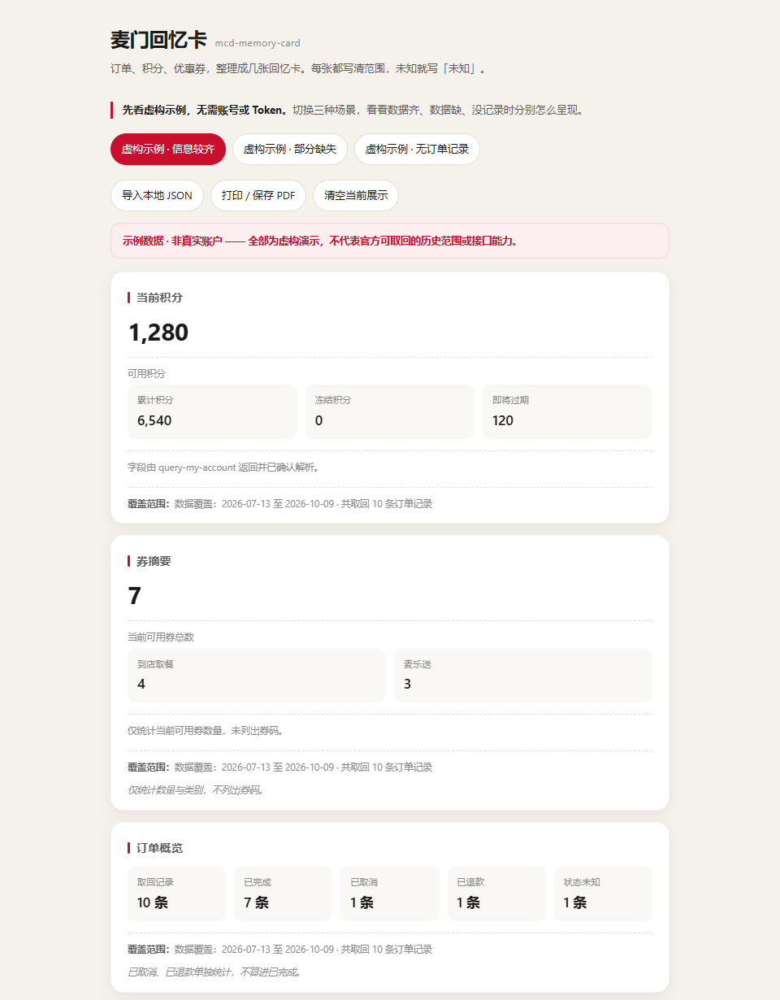
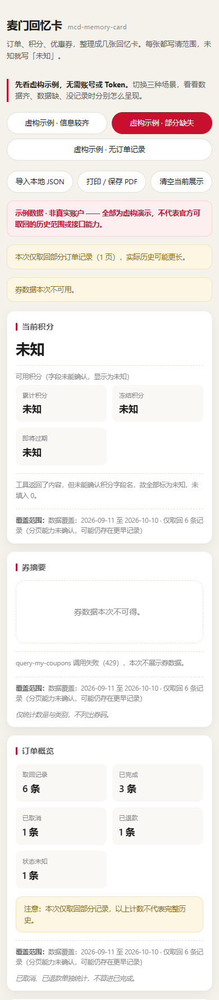
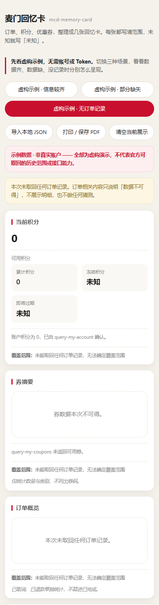

# 麦门回忆卡 · mcd-memory-card

**把麦当劳订单、积分与优惠券，整理成几张有据可查的回忆卡。**

看得见当前状态，也看得见数据的边界：每张卡标注范围，未知就写「未知」，取消和退款单独统计。

**[下载后立即试玩](https://github.com/liaoli-hero/mcd-memory-card/archive/refs/heads/main.zip)** · [三步打开演示](#三步打开演示) · [接入自己的数据](#接入自己的数据) · [数据口径与限制](#数据口径与限制)

> 先体验，再配置：演示无需登录、无需 Token、无需安装技能。下方截图与内置三套示例均为**纯虚构数据**，不来自任何真实账户，也不代表官方接口可取得完整历史。



*实际浏览器截图，使用 `samples/fictional-full.json`。所有数值、订单和门店均为虚构。*

## 可以用它做什么

- **看当前状态**：把可用积分、即将过期的积分、可用券数量放在一起。
- **回顾已取回的订单**：区分已完成、取消、退款与状态未知；门店记录只来自订单。
- **保存一份回忆**：浏览器打印或保存为 PDF，也可截图留档。分享前检查并遮去个人信息。

适合想回顾近期记录的麦当劳用户，也适合研究 MCP 只读汇总与数据缺失处理的开发者。

## 三步打开演示

1. **[下载项目 ZIP](https://github.com/liaoli-hero/mcd-memory-card/archive/refs/heads/main.zip)**，先解压。
2. 双击解压后根目录的 **`index.html`**，用浏览器打开。
3. 页面默认展示虚构示例。切换 **「信息较齐 / 部分缺失 / 无订单记录」**，观察卡片如何处理不同情况。

这条试玩路径只需浏览器。文件直接打开时若读不到 `samples/`，页面会使用内嵌的精简虚构样例；部分说明与明细可能不同，不影响体验三种场景。

已有 Git 和 Python，也可以在本地服务器中打开完整样例文件：

```bash
git clone https://github.com/liaoli-hero/mcd-memory-card.git
cd mcd-memory-card
python -m http.server 8000 --bind 127.0.0.1
```

再打开 [http://127.0.0.1:8000/](http://127.0.0.1:8000/)。可用 `?data=full`、`?data=partial` 或 `?data=empty` 直接选择演示场景。

> GitHub 文件页只显示源码，不能直接运行 HTML。若浏览器打印菜单提供「另存为 PDF」，选择后即可保存；本项目没有单独的一键 PNG 导出功能。

## 三种场景，都把边界写清楚

| 虚构场景 | 可以留意的细节 | 示例文件 |
|---|---|---|
| 信息较齐 | 10 条记录中，7 条已完成、1 条取消、1 条退款、1 条状态未知；分开呈现 | [fictional-full.json](samples/fictional-full.json) |
| 部分缺失 | 积分字段无法确认时显示「未知」；券不可用；6 条记录不代表完整历史 | [fictional-partial.json](samples/fictional-partial.json) |
| 无订单记录 | 已确认的积分 0 与未知值同时存在；没有订单记录时不推断历史消费 | [fictional-empty.json](samples/fictional-empty.json) |

<details>
<summary>查看部分缺失与无订单记录的界面（均为纯虚构）</summary>

| 部分缺失 · 纯虚构 | 无订单记录 · 纯虚构 |
|---|---|
|  |  |

</details>

这些截图用于说明产品行为，**不是 MCP 真实调用的证明**。示例中的状态映射、时间跨度和分页数都是演示设定。

## 接入自己的数据

演示页与真实取数是两个步骤：**WorkBuddy + 麦当劳 MCP 负责只读取数，网页负责展示归一化 JSON。** 在网页中导入文件不会连接或验证麦当劳账户。

1. 从 [麦当劳 MCP 平台](https://open.mcd.cn/mcp) 申请自己的 Token，按 [MCP 接入说明](MCP_INTEGRATION.md) 配置 WorkBuddy 连接器。
2. 下载仓库中的 [mcd-memory-card-skill.zip](https://github.com/liaoli-hero/mcd-memory-card/raw/refs/heads/main/mcd-memory-card-skill.zip)。在 WorkBuddy 的技能管理中选择添加 / 上传技能并导入；具体入口以当前客户端为准。也可参考 [WorkBuddy 技能文档](https://open.workbuddy.cn/docs/skill)。**导入技能包不等于已配置 MCP 连接器。**
3. 在 WorkBuddy 对话中请求：

   > 帮我生成我的麦门回忆卡。只使用只读工具，按实际返回归一化；逐卡标注范围，无法确认的字段写未知，不推断完整历史或食用量。

4. 获得符合 [数据格式](schema/normalized.schema.json) 的 JSON 后，在 `index.html` 点击 **「导入本地 JSON」**。不要把 Token 或原始敏感响应放进文件。

网页在浏览器内解析导入文件，不上传文件、不存储令牌、不直接连接麦当劳服务。使用 HTTP 打开页面时，会从同一站点读取虚构演示 JSON；双击文件时可使用内嵌示例。

### 可选：生成静态卡片页

有 Python 3 时，可使用仅依赖标准库的渲染器：

```bash
python renderer/render.py samples/fictional-full.json -o out.html
```

打开生成的 `out.html` 即可查看、截图或打印。展示自己的数据时，将输入文件替换为本地归一化 JSON。静态渲染器不联网，不负责调用 MCP。

## 数据口径与限制

| 问题 | 本项目的处理 |
|---|---|
| 数据没取到，能按 0 展示吗？ | 不能。未知显示「未知」；只有已确认的 0 才显示 0。 |
| 取消、退款或未知状态算已完成吗？ | 不算。分别统计；无法识别的状态不猜测。 |
| 能生成「全年吃了多少」吗？ | 不作此承诺。订单不等于食用量，也不据此推断热量或营养。 |
| 查到附近门店，能算历史足迹吗？ | 不能。门店记录只来自实际订单数据。 |
| 卡片代表完整历史吗？ | 只代表本次实际取得的数据；逐卡说明覆盖范围与完整性。 |
| 能下单、兑换或领券吗？ | 本 Skill 仅使用三个只读工具，不提供这些写操作。 |

### 真实接入验证到哪一步

仓库 [2026-10-10 接入记录](MCP_INTEGRATION.md#5--真实接入验证结果2026-10-10-实测) 记载：通过 WorkBuddy 调用了 `query-my-account`、`order-list` 和 `query-my-coupons`，未调用写工具。

- 账户工具返回 JSON，券工具返回 Markdown；券分页已记录实测结果。
- 订单工具调用成功，但返回的 `data` 是空对象，**没有取得真实订单样本**。
- 真实订单状态枚举、时间格式与时区、查询时间窗口、订单分页能力仍未确认。

因此，演示里的完整订单卡与门店卡展示的是渲染能力；不能据此宣称真实订单流程已全部验证。以上为仓库已有记录，本次展示改版没有重新调用真实账户。

## 开发与贡献

| 文件 | 用途 |
|---|---|
| [index.html](index.html) | 单文件演示、JSON 导入与浏览器打印 |
| [samples/](samples/) / [schema/](schema/) | 三套虚构数据与归一化格式 |
| [SKILL.md](SKILL.md) / [skill/](skill/) | 技能说明与可打包源文件 |
| [renderer/](renderer/) | 静态渲染器及现有校验脚本 |
| [MCP_INTEGRATION.md](MCP_INTEGRATION.md) | MCP 工具、流程、历史接入证据与限制 |
| [mcp-config.example.json](mcp-config.example.json) | 仅含环境变量占位符的配置示例 |
| [workbuddy.md](workbuddy.md) | 脱敏开发记录 |
| [截图方案](docs/SCREENSHOT_PLAN.md) | 截图来源、构图与复拍步骤 |

欢迎在 [Issue](https://github.com/liaoli-hero/mcd-memory-card/issues) 反馈复现步骤或改进建议。请使用虚构数据，勿提交 Token、券码、真实订单号或账户信息。喜欢或觉得有用，可自愿 Star 收藏；不提供任何交换或奖励。

## 参赛与许可

本作品参加麦当劳程序员创意开发大赛，[参赛 Issue #332](https://github.com/M-China/mcd-developer-innovation-challenge/issues/332) 已收到官方成功参赛回复。报名确认不代表获奖或官方产品背书。我们遵守 [活动规则](https://github.com/M-China/mcd-developer-innovation-challenge/blob/main/activityGuidelines.md)，不采用购买、互刷、奖励换 Star 或骚扰式推广。

作者：[@liaoli-hero](https://github.com/liaoli-hero)。使用 WorkBuddy 与 Codex 辅助开发，记录见 [workbuddy.md](workbuddy.md)。源码采用 [MIT License](LICENSE)，[参赛声明](CONTEST_DECLARATION.md) 保留官方原文。

本项目**非麦当劳官方产品**。品牌名称、商标及第三方素材的权利归各自权利人所有；输出不构成医疗或营养建议，业务信息以官方渠道为准。
